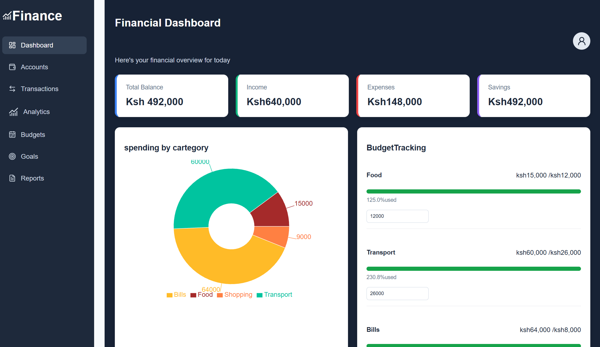

Financial Dashboard

A full-stack financial management application built with React, Node.js, Express, and MongoDB. It helps users track income and expenses, manage budgets, monitor savings goals, and understand their financial activity through interactive charts.

Live Demo

View Financial Dashboard

Features

Dashboard: Overview of income, expenses, balance, and recent transactions.

Transaction Management: Add, view, edit, and delete transactions.

Accounts: Dedicated accounts page.

Analytics: Interactive charts showing spending patterns and cash flow.

Budget Management: Set and update spending limits by category.

Savings Goals: Monitor savings progress.

Reports: Dedicated financial reports page.

Responsive Design: Layout adapted for desktop and mobile screens.

Data Persistence: Transactions and budgets stored through a backend API and MongoDB.

Technologies Used

Frontend

React

JavaScript

Vite

React Router

Recharts

Lucide React

CSS

Backend

Node.js

Express.js

MongoDB

Mongoose

REST API

Screenshots

Installation and Setup

Clone the repository:

git clone https://github.com/64lucy/financial-dashboard.git

Navigate to the frontend project:

cd financial-dashboard/financial-dashboard-react

Install dependencies:

npm install

Start the development server:

npm run dev

Open the local URL provided by Vite in your browser.

Project Purpose

This project was developed to apply practical frontend and backend development skills by building a financial management application with real API integration and persistent database storage.

Author

Lucy Murage

GitHub: 64lucy